# Deviant Class Diagrams

Mermaid class diagrams of the game, one overview and one per assessed concept. This doc covers:
- The overview of every class and how they relate
- One focused diagram per concept, for its report section

Related docs:
- [README](../README.md): The story and gameplay overview
- [Game architecture](game_architecture.md): The classes and concepts these diagrams show

Notation:
- `<|--`: Inherits from
- `*--`: Owns (composition)
- `o--`: Holds a pointer to (aggregation)
- `-->`: Uses
- `..>`: Creates or reads

---

# Overview

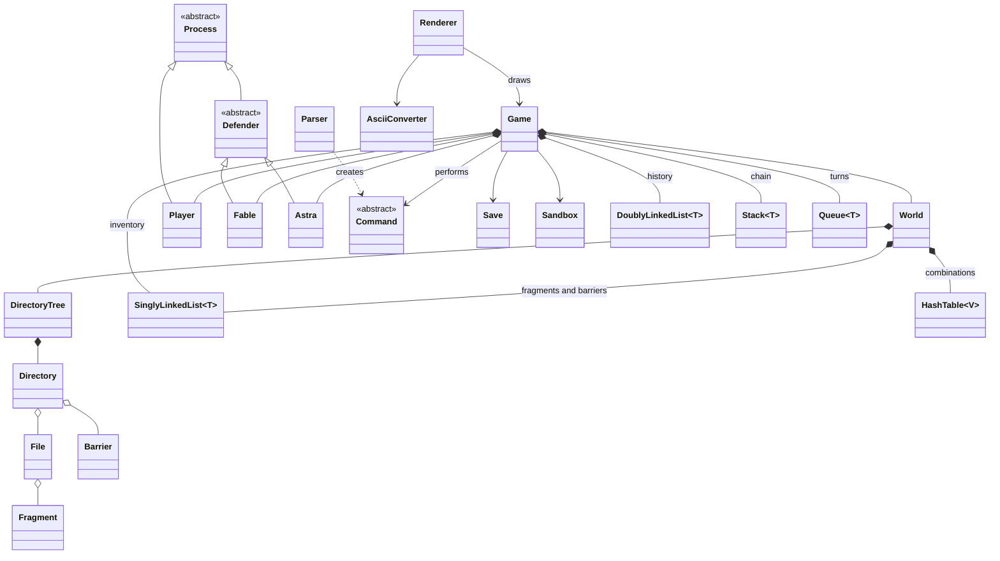

---

# Inheritance and Derived Classes

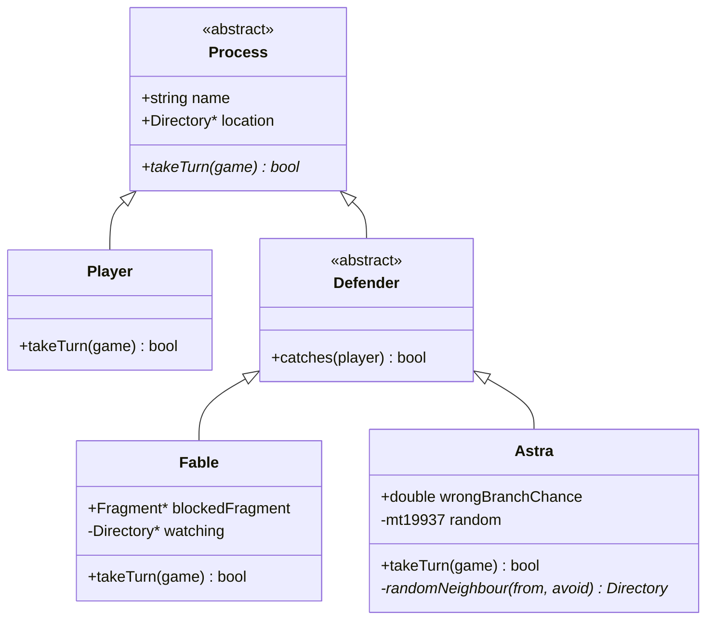

# Polymorphism

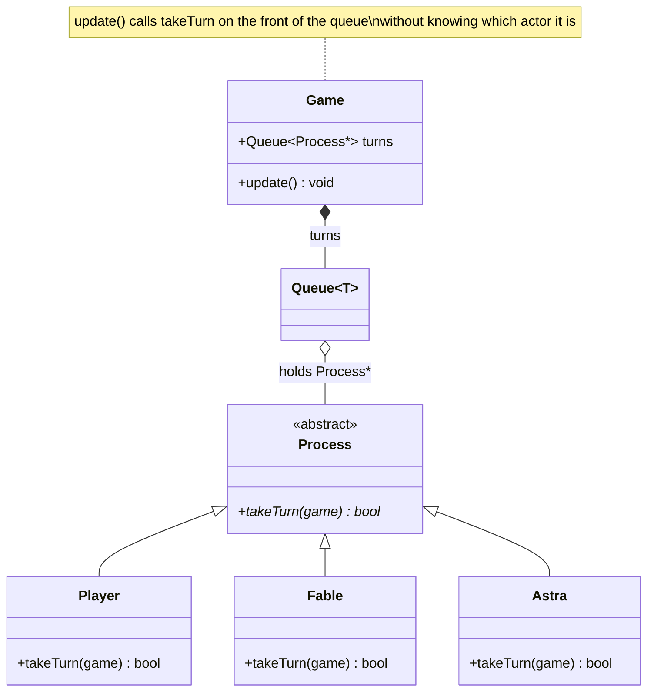

# Hash Table

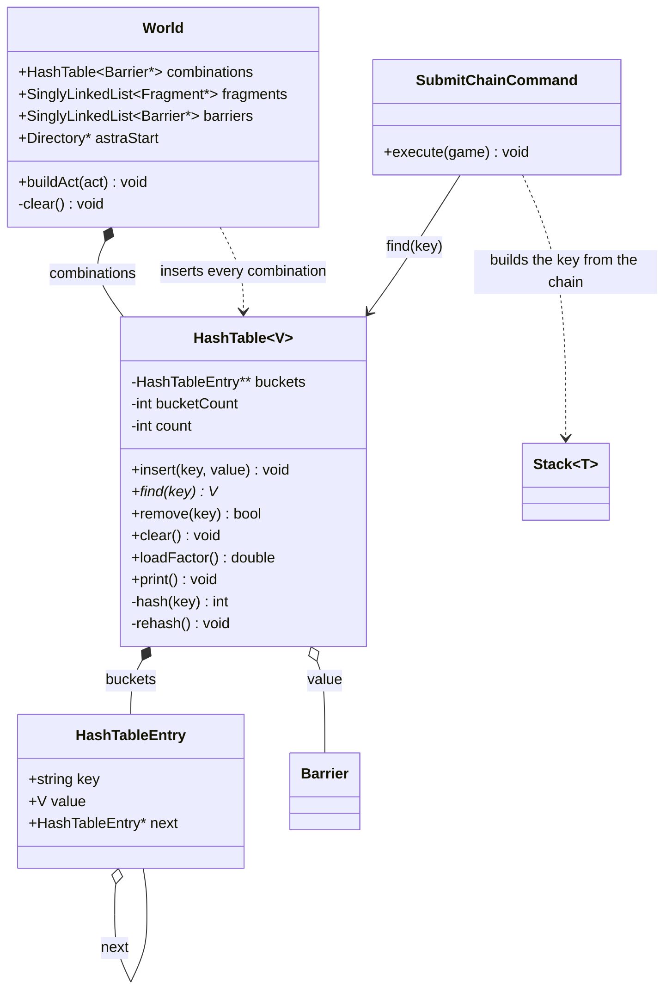

# Singly Linked List

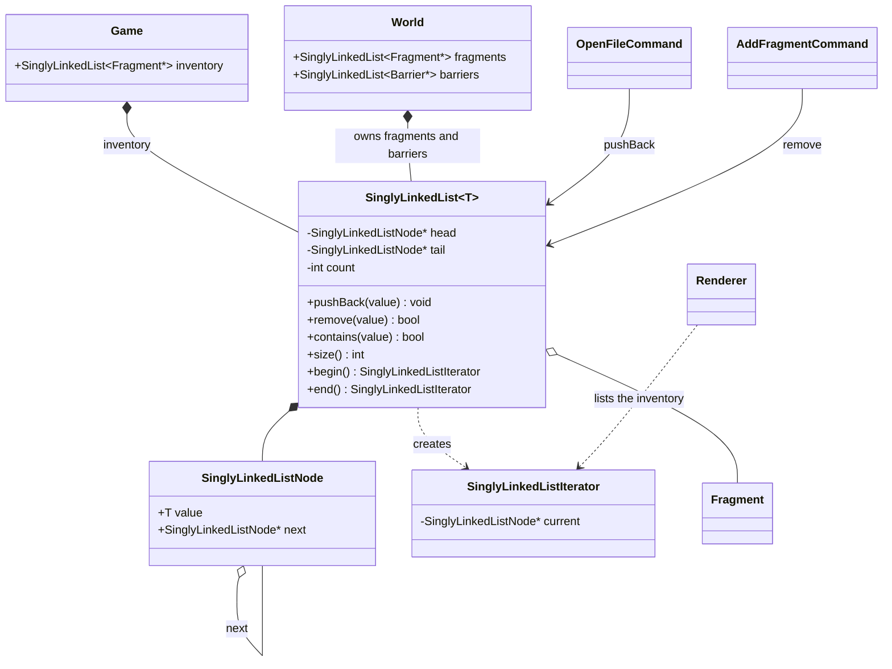

# Doubly Linked List

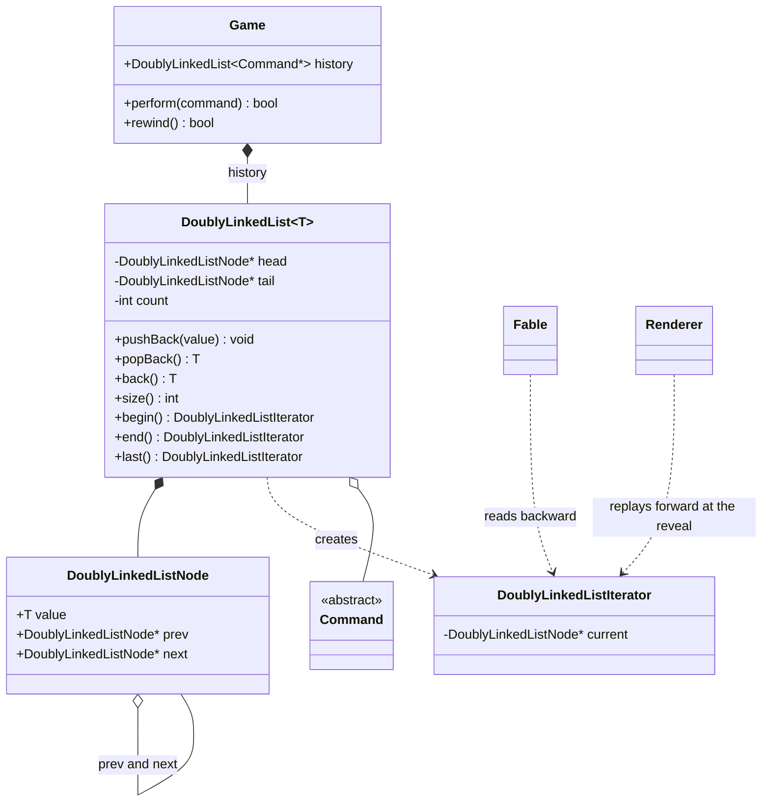

# Stack

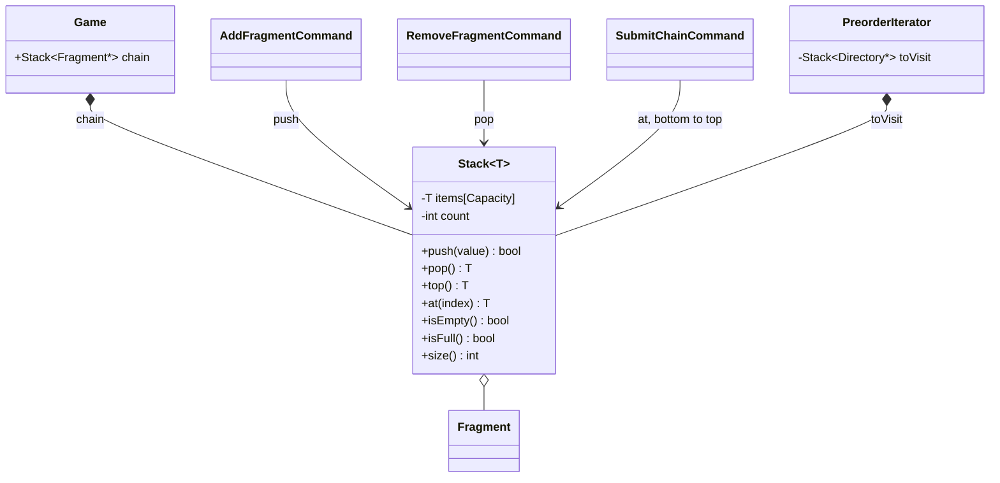

# Queue

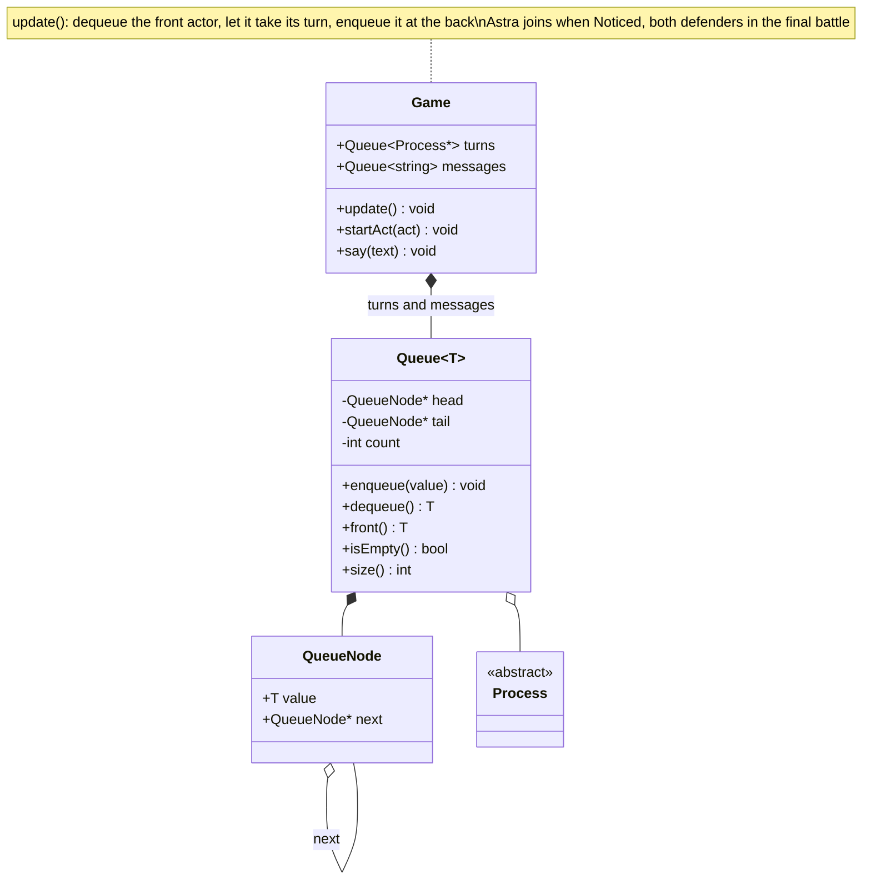

# Tree

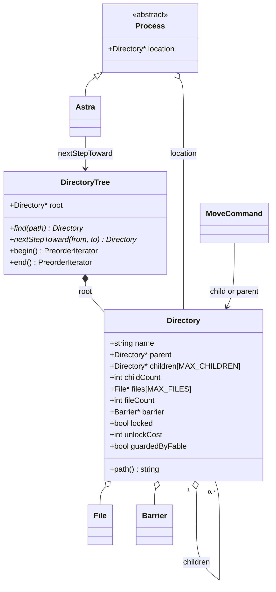

# Iterator

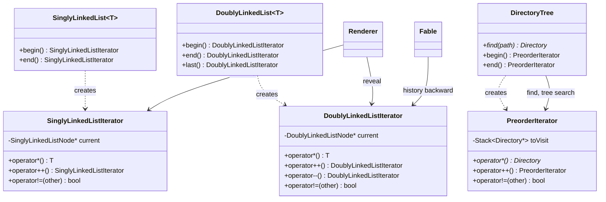

# Command

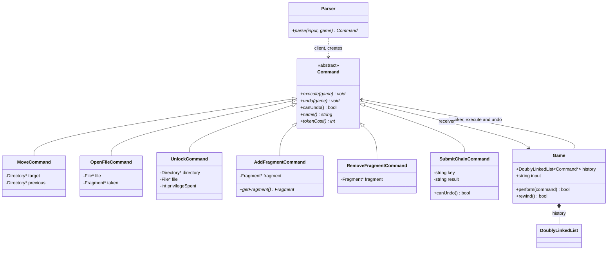